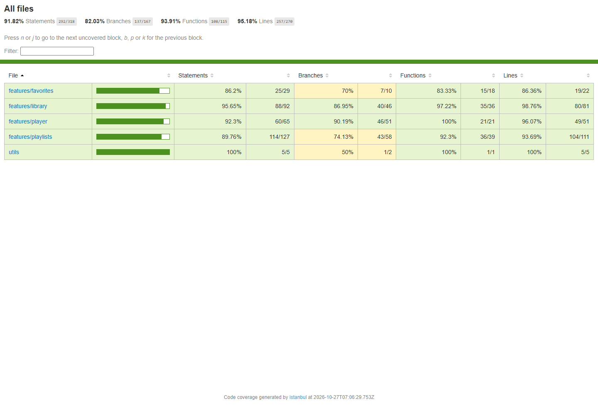

# Mini Player — LTWNC TH02

Trình phát nhạc mini (không phát âm thanh thật) xây dựng bằng React + TypeScript + Vite.
Bài thực hành tập trung vào quản lý state (Zustand, Context + `useReducer`), tối ưu hiệu
năng khi làm việc với 10.000 bài hát và kiểm thử bằng Vitest.

- **Mã sinh viên:** B23DCCC150
- **Repo:** `B23DCCC150_LTWNC_TH02`
- **Build tag:** `mz-4073`
- **Node.js:** 22.12+ (đã kiểm tra với Node 22.22)

## Chức năng

### Phần 1 — Thư viện 10.000 bài hát

- React Router v6 với các route `/`, `/favorites`, `/playlists`, `/playlists/:id`.
- Danh sách ảo hóa bằng `FixedSizeList` của `react-window` (cao 560px, mỗi dòng 56px),
  khóa ổn định theo `song.id`.
- `SongRow` bọc `React.memo`, callback bọc `useCallback`, danh sách ảo hóa bọc thêm
  `memo` để không render lại trong lúc đang gõ tìm kiếm.
- Tìm kiếm theo tên bài/ca sĩ với hook generic `useDebounce` (300ms).
- Lọc theo thể loại, sắp xếp theo tên (`localeCompare(..., 'vi')`) hoặc thời lượng.
- Dòng kết quả `Tìm thấy N bài hát`, trạng thái rỗng rõ ràng.

### Phần 2 — Player + Yêu thích

- `usePlayerStore` (Zustand) quản lý hàng đợi, bài hiện tại, trạng thái phát, vị trí.
- `PlayerBar` cố định ở đáy, đồng hồ `setInterval` 1 giây chỉ chạy khi đang phát.
- `ProgressBar` là component duy nhất đọc `position`, nhờ vậy danh sách và nút điều khiển
  không render lại mỗi giây.
- Yêu thích dùng store riêng + middleware `persist`, khóa `music-favorites`.
- Trang `/favorites` có `Phát tất cả`, tổng thời lượng và trạng thái rỗng.

### Phần 3 — Playlist + giao diện

- `playlistReducer` thuần với `PlaylistAction` là discriminated union:
  `create`, `rename`, `remove`, `addSong`, `removeSong`.
- `withLogger` log tên action + state trước/sau khi `import.meta.env.DEV`.
- Tách `PlaylistStateContext` / `PlaylistDispatchContext`, hook báo lỗi khi dùng ngoài Provider.
- Playlist được lưu ở `music-playlists` trong `localStorage`.
- Trang danh sách playlist có validate tên trống/trùng (không phân biệt hoa thường),
  trang chi tiết có tổng thời lượng, bỏ bài và phát tất cả.
- Ô **Playlist đang chọn** ở Thư viện + nút **+ Playlist** trên từng dòng.
- `ThemeContext` riêng cho giao diện sáng/tối, value bọc `useMemo`.
- Ba trang `/favorites`, `/playlists`, `/playlists/:id` được `React.lazy` + `Suspense`
  và tách thành chunk JS riêng khi build.

### Phần 4 — Kiểm thử

- **53 test** trong 12 file, tên test bằng tiếng Việt.
- Unit test cho `formatDuration`, dữ liệu sinh 10.000 bài, reducer, player store,
  `useDebounce`; component test cho `SongRow`, `PlayerBar`, `LibraryPage`,
  `FavoritesPage`, `PlaylistsPage`, `PlaylistDetailPage` và `App`.
- Dùng fake timers cho debounce/đồng hồ, `renderHook`, `userEvent`, mock `vi.fn()`.

## Kết quả kiểm tra

```text
Test Files  12 passed (12)
Tests       53 passed (53)
```

| Metric     | Kết quả |
| ---------- | ------- |
| Statements | 91.82%  |
| Branches   | 82.03%  |
| Functions  | 93.91%  |
| Lines      | 95.18%  |



## Công cụ quản lý state

| Loại state | Công cụ |
| --- | --- |
| Bài đang phát, hàng đợi, vị trí (đổi mỗi giây) | Zustand + selector |
| Bài hát yêu thích | Zustand + `persist` |
| Playlist | Context + `useReducer`, tách 2 Context |
| Giao diện sáng/tối | Context riêng + `useMemo` |
| Ô tìm kiếm, bộ lọc, form | `useState` cục bộ |

## Cài đặt và chạy

```bash
npm install
npm run dev       # chạy dev server
npm run build     # kiểm tra TypeScript + build production
npm test          # chạy 53 test
npm run coverage  # báo cáo coverage (HTML tại coverage/index.html)
```

## Cấu trúc

```text
src/
├── App.tsx, main.tsx, types.ts, setupTests.ts
├── data/            songs.ts, songIndex.ts
├── utils/           format.ts
├── hooks/           useDebounce.ts
├── contexts/        ThemeContext.tsx
└── features/
    ├── library/     LibraryPage.tsx, VirtualSongList.tsx, SongRow.tsx
    ├── player/      usePlayerStore.ts, PlayerBar.tsx, ProgressBar.tsx
    ├── favorites/   useFavoritesStore.ts, FavoritesPage.tsx
    └── playlists/   playlistReducer.ts, withLogger.ts, PlaylistContext.tsx,
                     PlaylistsPage.tsx, PlaylistDetailPage.tsx
```

> Lưu ý kỹ thuật: dòng đầu tiên của `src/App.tsx` là `const BUILD_TAG = "mz-4073";`
> và handler của ô tìm kiếm tên là `handleQueryShift`.
